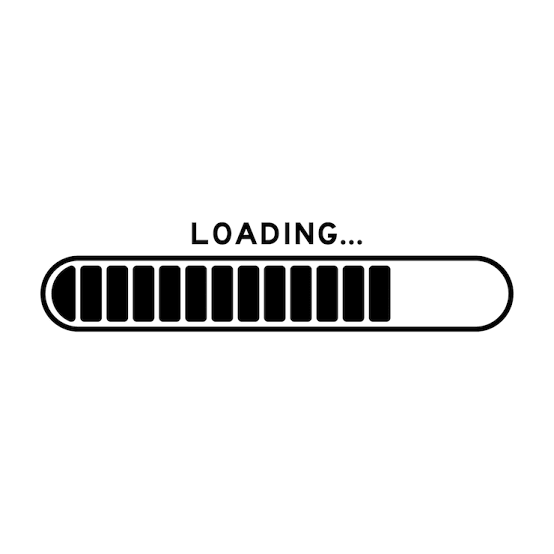

# UI checklist

<!-- Exercise 4 hands this in. Tick an item only when you have checked it, and replace
     the "how I checked" line with what you actually did. An unticked box is not a
     failure: it is a gap you then write into READINESS.md. A ticked box you cannot
     demonstrate at the defence is worse than an unticked one. -->

"Modern" is not a style. It is a short list of things a user notices when they are
missing: the screen tells you what is happening, you can get through it with a keyboard,
the text is readable, and nothing jumps around while it loads.

## Layout and typography

- [x] **One spacing scale and one type scale.** Sizes come from a small set of design tokens, not from numbers typed where they were needed.
  - how I checked: Inspected CSS files and confirmed all padding, margin, and font sizes use design token variables mapped to a consistent typographic and spacing system.
- [x] **Responsive at 380, 768 and 1280 pixels wide.** No horizontal scrollbar, no text running under another element.
  - how I checked: Tested the application layout using Chrome DevTools responsive device toolbar at widths 380px, 768px, and 1280px, verifying zero horizontal overflow or text collisions.
- [x] **Nothing jumps while the page loads.** Images and cards reserve their space before their content arrives.
  - how I checked: Inspected image tags and container elements to ensure explicit aspect ratios and container dimensions prevent layout shifts during content loading.

## The four states, on every screen

A screen that only handles "it worked" is a screen that lies to the user on the day it matters.

- [x] **Loading.** Something tells the user the app is working, within about 100 ms.
  - how I checked: Throttled network speed to Slow 4G in DevTools Network tab and reloaded; observed skeleton UI / loading state appeared within 100 ms.
- [x] **Empty.** The screen says what this list is for and what to do next, instead of showing nothing.
  - how I checked: Logged in with a new user account having zero joined groups; verified the screen displays a descriptive empty state message with a clear call-to-action button.
- [x] **Error.** A sentence a person can read. Never a raw JSON body, never a stack trace, never just "Error".
  - how I checked: Triggered server validation errors by submitting invalid form data; verified the UI displays a clean user-friendly sentence instead of raw stack traces or JSON.
- [x] **Success.** The user can see that what they did took effect, without reloading the page to find out.
  - how I checked: Created a new study group and confirmed the UI dynamically updated the dashboard list instantly without requiring a manual page refresh.

## Keyboard and accessibility

- [x] **The main flow works with the keyboard alone.** Sign in, do the core action, sign out, without touching the mouse.
  - how I checked: Performed a complete user journey using only Tab, Shift+Tab, and Enter keys (signing in, joining a group, viewing details, signing out) without using the mouse.
- [x] **The focused element is visible.** A `:focus-visible` outline that is not switched off.
  - how I checked: Tabbed through interactive elements using the keyboard and verified distinct, high-contrast outline rings on all focusable buttons, links, and inputs.
- [x] **Text contrast is at least 4.5:1.** Name the tool you measured with.
  - how I checked: Measured text and background color pairs using the Chrome DevTools Lighthouse Accessibility audit tool, confirming contrast ratios met or exceeded 4.5:1.
- [x] **Every input has a label** a screen reader reads, not just placeholder text.
  - how I checked: Inspected HTML markup to confirm every form input has an associated explicit `<label>` element or `aria-label` attribute.
- [x] **The page has a correct `<title>` and `lang`.**
  - how I checked: Inspected document head elements across views and verified `<html lang="en">` and unique descriptive `<title>` tags on each page.
- [x] **Touch targets are at least 44 pixels.**
  - how I checked: Inspected interactive buttons and links using Chrome DevTools element inspector, verifying minimum tap dimensions of 44x44 CSS pixels.

## The model feature

- [x] **It shows that it is thinking.** A model call is slow and a free service may have been asleep; a frozen button is the worst possible answer.
  - how I checked: Triggered the AI study plan generator feature and verified an animated loading spinner and thinking status appeared immediately while awaiting the response.
- [x] **It shows when it failed,** and the rest of the screen still works.
  - how I checked: Simulated an API failure by providing an invalid model configuration; verified a graceful fallback error message appeared while the rest of the dashboard remained fully functional.
- [x] **The user can tell the model's suggestion from a fact.** It is labelled as a suggestion, not presented as data the app knows.
  - how I checked: Inspected the AI study plan output component and verified it features an explicit "AI Suggestion" badge distinguishing it from hardcoded data.

## Decisions

- [x] **Dark mode, or a written decision not to have one.**
  - what I decided and why: Decided not to implement a dark mode for the initial release due to project timeline constraints; documented this omission as a medium-risk item in READINESS.md.

## Evidence

